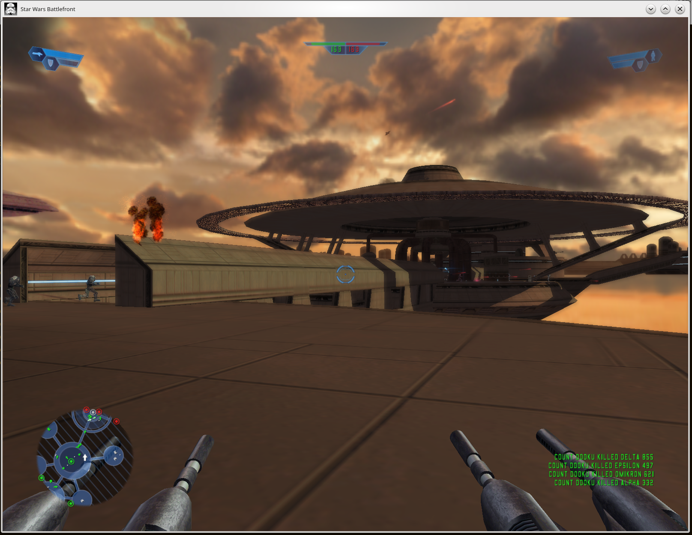
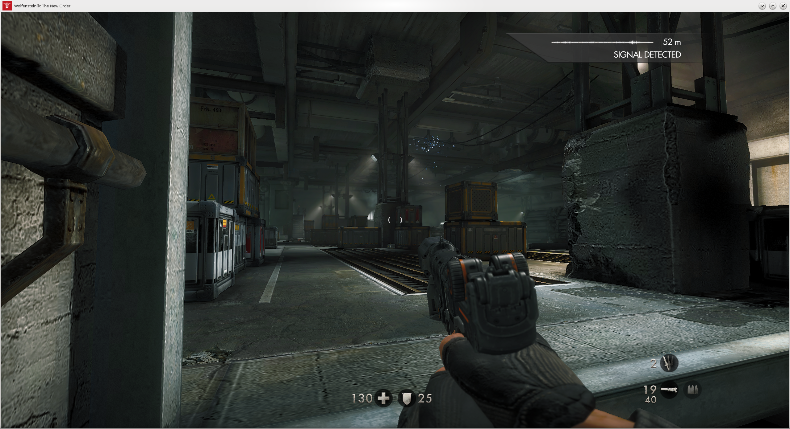
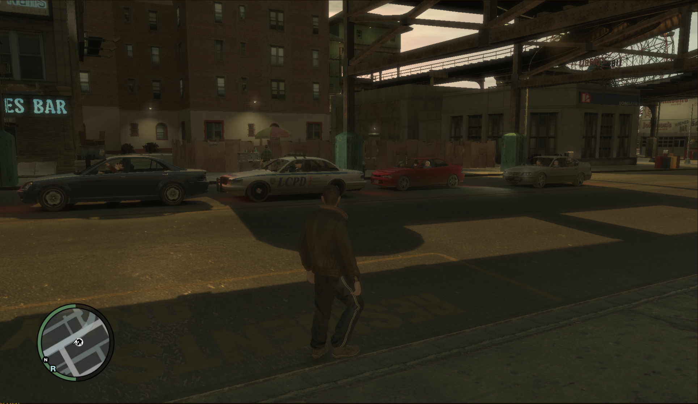
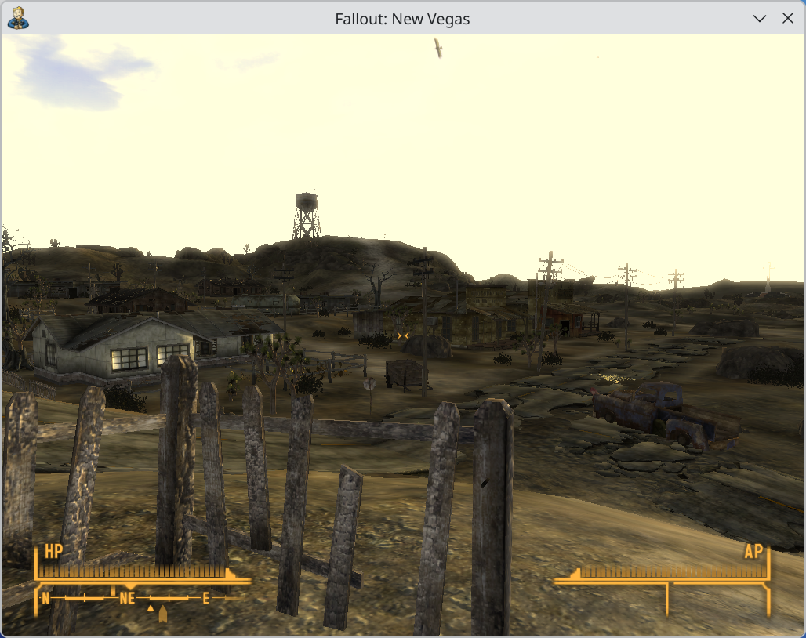

+++
date = "2026-11-07T14:30:00+10:00"
draft = false
title = "Progress Report: Linux 7.3"
slug = "progress-report-7-3"
author = "James Calligeros"
+++

Well here we are again. Linux 7.3 is out and it's been an eventful few months, so
let's get stuck in to another Asahi Linux progress report!

## Upstreaming continues
As always, upstreaming work continues to progress. Aside from the usual patches for
low-level SoC blocks, two major drivers made it on to the list this cycle: macaudio
and avd. Getting macaudio ready for submission has been a challenge. The audio subsystem
on Apple Silicon devices is rather special, and required quite a number of core ALSA
changes to properly support it. Apple also uses special variants of speaker and headset
amplifiers that were already supported upstream, and these drivers also needed some
pretty significant modifications. We have previously discussed a lot of this work at
length, and we are finally in a position where we can submit the main driver for
review. The driver and Devicetree changes represent a hefty chunk of our total patchset,
about 3100 lines. 

AVD is a whole different beast. The AVD driver has spent barely 3 months in our downstream
tree and is already on the list. This is our shortest turnaround time yet for a major
SoC component and bodes well for a transition to upstream-first development some time
in the future. This is fantastic news, as the AVD driver and related Devicetree changes
are around 13000 lines of code.

Also making an appearance on the list this cycle are intial Devicetrees not only for M4 Pro
and Max devices but also M5 thanks to Yureka's tireless efforts. As usual these initial
Devicetrees are barebones and only sufficient to boot the SoC to a TTY, however work
is progressing on further enablement. Watch this space!

We have also begun shifting to an upstream-first approach where practical. Changes
to the TI USB-PD and SPMI drivers required for new devices, as well as initial support
for Thunderbolt, were all developed upstream-first. We are so thrilled to see
our focus on upstreaming starting to pay off!

## M3 goes GA
Last time, we announced initial support for M3 series machines via the EXPERT flag on
the Asahi installer. We are pleased to announce that we received almost no issues
from early adopters, so M3 support is now generally available without the EXPERT flag!

We have also made a number of improvements to M3 support, most notably enabling DCP.
On top of performance and battery life improvements, this also allows us to enable
sleep on M3 series devices _and_ make the area around the notch useable on the MacBooks!
Keep an eye out for m1n1 and kernel updates in the coming days.

## Crowded House
Last time, we teased support for virtualising SPTM-enabled versions of macOS in m1n1,
which enables reverse engineering on M4 series machines. M5 presents a new challenge,
as the versions of macOS which support it all require the use of Exclaves.

Exclaves are small applications running in an isolated environment controlled by the
Secure Kernel. On M5 series SoCs and above, macOS uses them for sensitive tasks
such as drawing the "camera in use" indicator to the screen. XNU communicates with
the Secure Kernel and its Exclaves via SPTM, using yet another IPC protocol called
Tightbeam. Much as with SPTM, XNU will panic if it cannot find the running Exclaves.
This is all starting to look very similar in concept to Arm's own TrustZone feature.

While some Exclaves can be bypassed by changing some settings on the command line,
we predict that this will not always be the case. As such, Sven started looking at how we
could fit all of this in to m1n1. First line of investigation, try putting the
Secure Kernel and Exclave userspace in another VM next to SPTM and macOS.

[Oh, that worked](https://social.treehouse.systems/@sven/117513645155935201),
and we're now up to spawning three VMs in EL1 under m1n1! Maybe we can start
selling m1n1 to companies fleeing VMWare... With that, we can now virtualise
and reverse engineer macOS on both M4 and M5 series machines.

## Hello Triangle(s)!
While M3 support is now mostly at feature parity with M1 and M2, the very obvious exception
to this is the GPU. Apple's GPU team seems to follow a tick-tock model, and the M3's
GPU was a very significant departure from the models found on M1 and M2 SoCs. We mentioned
quite some time ago that the M3 GPU was being reverse engineered by a new group of
contributors, however not much has been said since.

At XDC this year, [Alyssa Millburn](https://social.treehouse.systems/@noopwafel),
[Anna Maniscalco](https://social.treehouse.systems/@pac85) and [TellowKrinkle](https://social.treehouse.systems/@TellowKrinkle)
gave a [talk](https://www.youtube.com/live/TPwe53kCJuM?t=2082) on their progress
reverse engineering the M3 GPU. Work has progressed far enough for m1n1 to successfully
initialise the GPU and for the team to draw a triangle! Fans of the "Think Different"
sections of these progress reports will find the talk edifying; Apple have once again
made a number of... interesting choices which will require significant engineering
effort to integrate into upstream Mesa. It is well worth a watch if you're interested
in more detail.

A huge thanks goes out to everyone who has made this work possible. More progress
is on the way, so stay tuned.

## Kept you waiting, huh?
All the way back in January of 2024, we made the [mistake](https://asahilinux.org/2024/01/fedora-asahi-new/)
of promising Thunderbolt support within the year. It's a mistake we won't quickly
repeat. We've said almost nothing about Thunderbolt in the two years since, which
begs the question: where is it?

[It's on the mailing list!](https://lore.kernel.org/asahi/20260906-b4-apple-soc-tbt-v2-0-1f80085f93fb@kernel.org/)

Thunderbolt was originally developed by Apple and Intel, with Intel handling the
design and fabrication of the hardware required. Since Intel made these controllers
available to anyone who wanted them at a (mostly) reasonable price, no one else
bothered to design their own. It is only very recently --- largely coinciding with
the transfer of the standard to the USB-IF --- that companies like AMD have decided
to roll their own controllers. Apple is of course no exception.

As part of their push for insourcing most silicon IP, Apple made the choice to
design their own Thunderbolt controller before most others. Surprising no one, the
controller is of course a Cortex-M3 running RTKit coupled with a bespoke
Thunderbolt/USB4 router. There is one of these for each Thunderbolt-enabled USB-C port
on all Apple Silicon Macs.

Since Intel supplies every other extant Thunderbolt controller on the market, the
Linux kernel's Thunderbolt subsystem is effectively designed around them. It makes
a number of assumptions about the hardware topology of the running machine, including
hardware capabilities and access patterns for certain registers and regions of
shared memory. Apple's controller breaks a lot of these assumptions. Great.

The Thunderbolt controller is also oddly coupled to PMGR. The reset line for each
controller is asserted or deasserted by setting and clearing a set of bits in the
middle of PMGR's MMIO range. No other hardware block works quite like this,
and it took some time to realise that these seemingly random writes to PMGR were
not just noise.

Luckily for us, Sven was up to the task of dealing with all this nonsense. It just
took slightly longer than expected! While the patchset to enable Thunderbolt was
sent upstream first (another massive win for us!), we  have also pulled it into
our downstream kernel and are now shipping it to users!

But there is a catch. Currently, only USB3, XDomain and Thunderbolt Networking are
supported. You can plug in USB devices or connect two Thunderbolt computers together
and make them ping each other, but that's about it. PCIe and DisplayPort tunnelling --- required for
most Thunderbolt docks --- are not supported. Yet. Watch this space.

An enormous amount of gratitude is owed to Sven, who has stuck with this thankless
chore for nearly 5 years in between all of his other incredible work.

## "The Holy Grail, Doctor Jones"
Playing retail PC games on Asahi Linux is a bit of a pain point, to say the least.
The software stack required to enable this is incredibly complex. We need to translate
x86/amd64 binaries to arm64, and do so fast enough for low-latency gaming. In most
cases, we also need to deal with the Windows API. On top of that, almost all games
bake in an assumed 4 KiB memory page size to enable certain performance optimisation.
Over the past few years, most of these problems have been solved:

- FEX has improved leaps and bounds. The performance and reliability of binary
  translation is hardly a consideration in most cases now;
- WINE is also fantastic now. Support for ARM64EC is mature and reliable,
  meaning that FEX now only has to translate the game binaries rather than
  WINE's entire Windows API implementation; and
- muvm allows us to spin up a thin VM with DRM Native Context to present
  a 4 KiB memory page size to x86/amd64 applications.
  
When muvm was first developed, it was with the assumption that DRM Native Context
would enable near-native GPU performance from inside the VM. Unfortunately, this
assumption did not hold. The muvm performance penalty is quite significant for
a number of reasons, about 20% depending on the workload. Engineering around
the limitations inherent to using a VM also introduces issues; muvm cannot use
Wayland, has slow I/O performance, and struggles with certain types of input devices.

This is one area where macOS has us completely licked. While the performance gap
between FEX and Rosetta has narrowed, XNU allows userspace processes to map themselves
at any page granularity, so all Rosetta needs to do is tell XNU to map 4 KiB pages
for its child processes. Linux does not have this flexibility. All pages must be
mapped at the same granularity as the kernel. While we did [tease](https://asahilinux.org/2025/10/progress-report-6-17)
Windows games working outside of muvm last year, this relied on ugly hacks inside
FEX which have since been removed in the interests of maintainability and translation
correctness. Bummer. Even so, compatibility was hit-and-miss, with a lot of (mostly older)
software still refusing to work. Double bummer.

Android is currently going through a transition from 4 KiB pages to 16 KiB pages for
a variety of reasons. Google Play now requires apps to be built for 16 KiB systems,
and any application updates which do not test successfully on such systems will not
be approved for publication on the Play Store. What about applications which are
no longer updated though? What about sideloaded enterprise slop apps?

Google engineers Kalesh Singh and Frederick Mayle gave a very interesting [talk](https://lpc.events/event/20/contributions/2630/)
at Linux Plumbers Conference this year about exactly this. Their solution is simple:
just fix Linux so that userspace can map 4 KiB pages!

Their addition to the Android kernel is called P3S, or Per Process Page Size.
On ARM64 systems, pagetable granularity is controlled by bits set in the Translation Control Registers (TCR).
P3S works by tracking the granularity of each process's pagetables, and writing
the appropriate bits to the TCR whenever a process with a different pagetable size
is switched to. Because this is a single register write, and because this is
a no-op for "native" page size processes, the performance penalty is effectively
zero!

While this effort is primarily targeted at Android, the patchset mostly rebases
cleanly on top of mainline Linux. What happens if we rebase it on top of our
Asahi tree (and fix some bugs)? As it turns out:

<figure>
  
  <figcaption>Star Wars Battlefront (2004) running outside of muvm, with WineD3D</figcaption>
</figure>

Okay okay, Battlefront is a very simple Direct3D 9.0 game from 22 years ago.
Not exactly an impressive demo, right? Well what about:

<figure>
  
  <figcaption>Wolfenstein: The New Order (2014) running outside of muvm</figcaption>
</figure>

Wolfenstein: The New Order is one of the most well optimised native Vulkan
titles ever released, and being 64-bit uses WINE's ARM64EC pathways to
massively reduce the amount of work FEX has to do. Again, not exactly an
impressive demo if we're judging based on technical difficulty.

Let's find something else. Something... worse. Something 32-bit so that
FEX and WINE have to work harder. Something that will exercise DXVK too.
Something that is so comically buggy and poorly optimised that it doesn't
even work properly on real Windows machines, and relies on community patches
and command line switches to start at all on modern computers:

<figure>
  
  <figcaption>Grand Theft Auto IV (2008) running outside of muvm, with DXVK</figcaption>
</figure>

That's more like it! But we can do _even worse_. We can even run...
Bethesda games!

<figure>
  
  <figcaption>Fallout: New Vegas (2010) running outside of muvm, with DXVK</figcaption>
</figure>

Performance is of course still patchy. Both Battlefront and Wolfenstein
run essentially flawlessly, with the latter hitting 144+ FPS on an M2
Max Mac Studio. GTA IV on the other hand is... not fantastic. Performance
is still massively improved over using muvm, and eliminating the use of
the VM in general should also eliminate a few classes of bugs. Debugging
the GPU driver should also be much easier with this approach.

As always there is a catch, and unfortunately it's a big one.
The current solution is hard-coded for 16 KiB hosts and 4 KiB processes
on those hosts. This obviously satisfies Google's commercial requirements, but
adding pagesize-specific kludges to the kernel's core memory management code
is not appropriate upstream. We are unsure if Google intends to generalise
this approach and upstream it, or if this is going to stay an Android-only patchset.
As such, we do not want to ship this in our downstream tree and have folks
become reliant on it when there is this level of uncertainty.

It also requires userspace integration. P3S works by checking the binary
metadata for its sections' page alignments. This works for Google's
use case, as P3S is intended as a fallback mechanism for applications
aligned to 4 KiB pages. Modern arm64 binaries are aligned to 64 KiB however,
as this guarantees compatibility with systems of all native pagesizes. Thus,
a shim is required to force P3S on. The shim triggers P3S, and any
child processes will inherit its 4 KiB pagesize. It is not worth spending
the effort on implementing this until we have some certainty around what
Google intends to do with this patchset.

We have reached out to Google with some questions, and we hope to have more
to say soon.

## Mics, but faster
Our custom beamformer for the microphone array found in the MacBooks is written
in Rust. Rust's scientific computing ecosystem is not as mature as C++'s, which
is a bit of a problem as beamforming requires realtime FFT and very heavy matrix
operations to be done on buffers filled with audio samples. Mature scientific
computing libraries have hand-optimised code, often using intrinsics tied to the
target ISA. We were not doing this however, and relied on the compiler autovectorising
code where it could to achieve our performance targets.

This fell apart when we eliminated the FFT-based analytic transform, replacing it
with an implementation based on infinite impulse response (IIR) filters. This
*should* be faster, however the compiler was failing to autovectorise the new
implementation. [Linkmauve](https://github.com/linkmauve) kindly stepped in and
added SIMD-optimised code for both arm64 *and* amd64. This, coupled with other
performance optimisations courtesy of [Frédéric Bour](https://github.com/let-def)
has resulted in Triforce becoming almost twice as fast, all while using less CPU
time!

## Keeping up
Fedora Linux 45 was released on 3 November, and we shipped
[Fedora Asahi Remix](https://fedoramagazine.org/fedora-asahi-remix-45-is-now-available/)
on the same day. This is the first time we have been able to get a new version of Fedora
Asahi Remix out on the same day as upstream!

## Learning from history
We take great pride in our work, and have always done _all_ of our development in the open.
We communicate with our users, our followers and our financial sponsors as transparently
as is humanly possible. Our finances are in the open, our development branches are in the open,
and we report our progress regularly and candidly in the open. Our IRC channels and Matrix rooms
are safe spaces, open to anyone with even a passing interest in Asahi Linux or hacking on Apple
Silicon.

We do all of this because we firmly believe in Free and Open Source Software, not just as a
means to an end but as the end in and of itself. The modern digital world is only possible
because of the Free Software movement, and it is more important now than it ever has been
that we do all we can to protect the Free Software ecosystem and uphold the ideals upon
which it is built.

It may surprise some to learn that WINE was originally made available under the MIT
licence. The 90s and 2000s were a very different time in the Free Software ecosystem,
and permissively licenced projects were viewed by tech companies as free real estate
to pilfer and exploit. WINE was not immune to this, and many monetised proprietary
forks of WINE were marketed and sold by various bad actors. The WINE development team
grew increasingly concerned that these proprietary forks, while well within their rights
to exist, would eventually cause so much fragmentation in the ecosystem that WINE itself
would become unviable. In 2002, WINE was relicenced under the LGPL to prevent further
proprietary forks from being created, and to encourage direct upstream contribution.

When Asahi Linux was first started, it was with the intent that we develop a Free Software
_ecosystem_ for the Apple Silicon platform. To facilitate and encourage the particiation
of our friends at the BSDs and other Free Software operating systems, we endeavoured to
licence as much of our code as possible under the permissive MIT licence.

Unfortunately, this is no longer viable. The malicious practices of the 90s and 2000s
have reared their ugly heads once again, this time driven in large part by both the
insatiable appetite of frontier AI labs for high-quality training data, and militant animosity
toward the Free Software community.

Some time ago, we were made aware of multiple attempts to exploit our permissive licensing
to hijack our work, with a direct view to replacing the project and aggressively monetising
Linux on Apple Silicon. In some extreme cases, in-development feature code was being
lifted straight out of our personal forks and published without attribution or lazily
rewritten with LLM assistance to obfuscate its origin. The MIT licence explicitly allows
this, and has no carveouts to protect against bad faith actors.

As such, we made the difficult decision to begin the process of transitioning all of
our repositories to the GNU General Public License version 2 or later. Going forward
all Asahi Linux code will be licenced under strong copyleft licences only. Those who
do not learn from history are doomed to repeat it.

## Until next time!
As always, we would like to sincerely thank our supporters on [OpenCollective](https://opencollective.com/asahilinux)
and [GitHub Sponsors](https://github.com/sponsor/AsahiLinux). It is only through
your generous backing that we are able to dedicate the time and resources to continuing
our work reverse engineering the platform and bringing to it a world-class, polished,
and battle-tested Linux desktop experience. You mean the world to us.

